# Awesome-Multi-Tenant-Data-Governance

<p align="center">
  
</p>

<p align="center">
  <a href="https://github.com/ishandutta2007/Awesome-Awesome-Awesome"></a><a href="https://discord.gg/jc4xtF58Ve"></a>
  <a href="https://github.com/ishandutta2007/Awesome-Multi-Tenant-Data-Governance/stargazers"></a>
  <a href="https://github.com/ishandutta2007/Awesome-Multi-Tenant-Data-Governance/network/members"></a>
  <a href="https://github.com/ishandutta2007/Awesome-Multi-Tenant-Data-Governance/issues"></a>
  <a href="https://github.com/ishandutta2007/Awesome-Multi-Tenant-Data-Governance/blob/main/LICENSE"></a>
  <a href="https://github.com/ishandutta2007"></a>
</p>

---

## 🧭 Overview & Ecosystem Architecture

Welcome to the definitive, SEO-optimized directory of **Multi-Tenant Data Governance Tools, Tenant Isolation Platforms, and Data Security Architectures**. 

In modern cloud platforms, multi-tenant B2B SaaS, and unified analytics environments, data isolation and governance are critical. These solutions govern fine-grained tenant isolation, attribute-based and role-based access control (ABAC/RBAC), automated sensitive data discovery (PII/PHI), dynamic data masking, row-level security (RLS), metadata cataloging, cross-tenant policy enforcement, and end-to-end data lineage tracking.

Whether you are designing a SaaS backend, implementing zero-trust data access for multi-org environments, or complying with GDPR, CCPA, HIPAA, SOC 2, and the EU AI Act, this curated guide benchmarks leading enterprise SaaS vendors alongside self-hosted open-source technologies.

---

## 📈 Sector Overview & Market Dynamics

The global data governance market is valued at approximately **$4.7B – $5.7B in 2025–2026** and is projected to expand to **over $20B – $26B by 2034–2035**, compounding at an aggressive **CAGR of ~18% to 21%**.

The sector remains **moderately to highly fragmented** rather than a winner-take-all monopoly: hyperscalers and legacy CRM/ERP monoliths (Salesforce, Microsoft) command baseline infrastructure data, while a fiercely competitive tier of high-growth specialized leaders (Collibra, OneTrust, BigID, Securiti, Atlan, Immuta) capture modern cloud data lakehouse governance, DSPM, and automated policy orchestration. Concurrently, a vibrant open-source ecosystem (Apache Ranger, OPA, OpenMetadata, OpenFGA, Keycloak, SpiceDB) powers self-hosted, tenant-isolated sovereign architectures across independent platform engineering teams.

---

## 📑 Table of Contents

- [📈 Sector Overview & Market Dynamics](#-sector-overview--market-dynamics)
- [🏢 SaaS & Hosted Enterprise Platforms](#-saas--hosted-enterprise-platforms)
- [🌐 Open-Source GitHub Projects](#-open-source-github-projects)
- [🏗️ Architectural Blueprint: Self-Hosted Governance Stack](#️-architectural-blueprint-self-hosted-governance-stack)
- [🤝 How to Contribute](#-how-to-contribute)
- [⭐ Star History](#-star-history)
- [💖 Support & Sponsorship](#-support--sponsorship)
- [⚖️ Disclaimer](#️-disclaimer)

---

## 🏢 SaaS & Hosted Enterprise Platforms

The table below highlights leading multi-tenant data governance SaaS solutions, sorted in descending order by enterprise scale (company valuation / market capitalization).

| Product | Enterprise Scale (Valuation / Revenue) | Starting Price (Specific Tier) | Free Tier / Trial Limits | Key Capabilities |
| :--- | :--- | :--- | :--- | :--- |
| **[Salesforce Data Spaces](https://www.salesforce.com/)** | **$189B Market Cap** ($41.5B FY26 Rev) | **$60,000 / year** (Data Cloud Starter Tier; 2.5M credits) | **Free 30-day trial** (Data Cloud trial org with test data credits) | Virtual multi-tenant partitioning to segregate data by brand, region, or subsidiary. |
| **[Collibra](https://www.collibra.com/)** | **$5.25B Valuation** | **$170,000 / year** (AWS Marketplace Base Platform Subscription) | **No free tier**; 14-day guided proof-of-concept trial upon sales approval | Enterprise data catalog, lineage tracking, and multi-tenant data stewardship policies. |
| **[OneTrust Data Governance](https://www.onetrust.com/)** | **$4.5B Valuation** | **$10,000 / year** (Base Governance & Consent Management Module) | **14-day free trial** (Standard Consent & Privacy module trial, up to 1 domain) | Cross-tenant consent enforcement, automated data mapping, and privacy compliance. |
| **[Securiti.ai](https://securiti.ai/)** | **$1.725B Valuation** (Acquired by Veeam) | **$35,000 / year** (Data Command Center Starter Tier) | **No free tier**; Free PrivacyOps & AI Governance Certifications only | Contextual data privacy, LLM/AI governance, and cross-tenant policy orchestration. |
| **[BigID](https://bigid.com/)** | **$1.3B Valuation** | **$25,000 / year** (BigID Next Foundation Module) | **No free tier**; 30-day scoped Sandbox PoC available via AWS Marketplace | ML-powered sensitive data discovery, classification, and multi-tenant DSPM. |
| **[Atlan](https://atlan.com/)** | **$1.2B Valuation** | **$100,000 / year** (Atlan Professional Base Contract) | **No free tier**; 14-day interactive sandbox demo environment | Modern metadata catalog with column-level lineage and tenant-aware access governance. |
| **[Immuta](https://www.immuta.com/)** | **$1.0B Valuation** | **$96,000 / year** (Starter Unit Tier - 960 Immuta Units) | **14-day free trial** (Full feature access in cloud sandbox with demo dataset) | Attribute-based access control (ABAC), dynamic data masking, and multi-tenant RLS. |
| **[Privacera](https://privacera.com/)** | **~$200M Valuation** ($50M Series B) | **$50,000 / year** (Privacera Cloud Foundation Subscription) | **30-day free trial** (AWS Marketplace Privacera Cloud trial instance) | Cloud-native policy management based on Apache Ranger for multi-tenant data estates. |

---

## 🌐 Open-Source GitHub Projects

Curated open-source multi-tenant governance repositories, authorization frameworks, and metadata engines. Sorted in descending order by **GitHub Stars_Count**.

| Project | GitHub_Stars | Primary Domain & Multi-Tenant Governance Focus | License |
| :--- | :--- | :--- | :--- |
| **[Apache Airflow](https://github.com/apache/airflow)** | [](https://github.com/apache/airflow/stargazers) | Workflow orchestration engine featuring tenant-isolated DAGs, role-based access control, and audit lineage integration. | Apache-2.0 |
| **[Keycloak](https://github.com/keycloak/keycloak)** | [](https://github.com/keycloak/keycloak/stargazers) | Open-source IAM offering out-of-the-box tenant realm partitioning, fine-grained authorization, and identity federation. | Apache-2.0 |
| **[HashiCorp Vault](https://github.com/hashicorp/vault)** | [](https://github.com/hashicorp/vault/stargazers) | Secret management, encryption-as-a-service, and multi-tenant namespace isolation for credential security. | BSL-1.1 |
| **[Casbin](https://github.com/casbin/casbin)** | [](https://github.com/casbin/casbin/stargazers) | Multi-model authorization library supporting multi-tenant RBAC, ABAC, and ACL across diverse programming languages. | Apache-2.0 |
| **[Dagster](https://github.com/dagster-io/dagster)** | [](https://github.com/dagster-io/dagster/stargazers) | Cloud-native data orchestrator built around asset lineage, tenant workspaces, and governance metadata. | Apache-2.0 |
| **[OpenMetadata](https://github.com/open-metadata/OpenMetadata)** | [](https://github.com/open-metadata/OpenMetadata/stargazers) | Centralized metadata platform delivering team domains, data discovery, lineage, automated profiler, and tenant policy hooks. | Apache-2.0 |
| **[DataHub](https://github.com/datahub-project/datahub)** | [](https://github.com/datahub-project/datahub/stargazers) | LinkedIn's extensible metadata platform providing 360-degree cataloging, tenant domain segregation, and access workflows. | Apache-2.0 |
| **[Open Policy Agent (OPA)](https://github.com/open-policy-agent/opa)** | [](https://github.com/open-policy-agent/opa/stargazers) | General-purpose policy engine with declarative Rego syntax for unifying context-aware, tenant-isolated authorization. | Apache-2.0 |
| **[Great Expectations](https://github.com/great-expectations/great_expectations)** | [](https://github.com/great-expectations/great_expectations/stargazers) | Data validation, quality documentation, and automated testing integrated into multi-tenant pipeline governance. | Apache-2.0 |
| **[OpenBao](https://github.com/openbao/openbao)** | [](https://github.com/openbao/openbao/stargazers) | Community-driven, fully open-source fork of Vault managed under the Linux Foundation for tenant secret governance. | MPL-2.0 |
| **[SpiceDB](https://github.com/authzed/spicedb)** | [](https://github.com/authzed/spicedb/stargazers) | Zanzibar-inspired high-scale permissions database implementing ReBAC across complex multi-tenant relationships. | Apache-2.0 |
| **[Cloud Custodian](https://github.com/cloud-custodian/cloud-custodian)** | [](https://github.com/cloud-custodian/cloud-custodian/stargazers) | Rules engine for cloud security, compliance, cost optimization, and multi-tenant cloud account governance. | Apache-2.0 |
| **[Permify](https://github.com/Permify/permify)** | [](https://github.com/Permify/permify/stargazers) | Open-source authorization engine built on Google Zanzibar models for fine-grained multi-tenant permissioning. | Apache-2.0 |
| **[OpenFGA](https://github.com/openfga/openfga)** | [](https://github.com/openfga/openfga/stargazers) | CNCF relationship-based access control engine inspired by Zanzibar, tailored for multi-tenant microservices. | Apache-2.0 |
| **[Pomerium](https://github.com/pomerium/pomerium)** | [](https://github.com/pomerium/pomerium/stargazers) | Identity-aware reverse proxy providing context-driven, tenant-isolated data ingress and authorization. | Apache-2.0 |
| **[Amundsen](https://github.com/amundsen-io/amundsen)** | [](https://github.com/amundsen-io/amundsen/stargazers) | Lyft's metadata catalog and search platform indexing data assets across multi-tenant enterprise data lakes. | Apache-2.0 |
| **[Cerbos](https://github.com/cerbos/cerbos)** | [](https://github.com/cerbos/cerbos/stargazers) | Declarative access control decision point separating authorization policy logic from multi-tenant application code. | Apache-2.0 |
| **[OPA Gatekeeper](https://github.com/open-policy-agent/gatekeeper)** | [](https://github.com/open-policy-agent/gatekeeper/stargazers) | Validating webhook and policy controller enforcing multi-tenant cluster isolation on Kubernetes. | Apache-2.0 |
| **[Unity Catalog](https://github.com/unitycatalog/unitycatalog)** | [](https://github.com/unitycatalog/unitycatalog/stargazers) | Open universal catalog for data, tables, files, and AI models with fine-grained access control across lakehouses. | Apache-2.0 |
| **[Oso](https://github.com/osohq/oso)** | [](https://github.com/osohq/oso/stargazers) | Batteries-included authorization framework with Polar declarative language for multi-tenant SaaS authorization. | Apache-2.0 |
| **[OpenLineage](https://github.com/OpenLineage/OpenLineage)** | [](https://github.com/OpenLineage/OpenLineage/stargazers) | Open standard for metadata and data lineage collection across multi-tenant pipelines and transformation jobs. | Apache-2.0 |
| **[Soda Core](https://github.com/sodadata/soda-core)** | [](https://github.com/sodadata/soda-core/stargazers) | Data quality and observability CLI/library checking pipeline contracts and tenant dataset validity. | Apache-2.0 |
| **[Marquez](https://github.com/MarquezProject/marquez)** | [](https://github.com/MarquezProject/marquez/stargazers) | Lineage metadata engine with multi-tenant namespace support tracking dataset lifecycles and schema evolution. | Apache-2.0 |
| **[Apache Atlas](https://github.com/apache/atlas)** | [](https://github.com/apache/atlas/stargazers) | Scalable metadata management and classification framework with lineage tracking for multi-tenant big data estates. | Apache-2.0 |
| **[Apache Polaris](https://github.com/apache/polaris)** | [](https://github.com/apache/polaris/stargazers) | Open-source catalog for Apache Iceberg tables providing centralized multi-tenant credential vending and RLS. | Apache-2.0 |
| **[Netflix Metacat](https://github.com/Netflix/metacat)** | [](https://github.com/Netflix/metacat/stargazers) | Netflix's federated metadata service facilitating unified multi-tenant data discovery and schema governance. | Apache-2.0 |
| **[Apache Griffin](https://github.com/apache/griffin)** | [](https://github.com/apache/griffin/stargazers) | Open-source distributed data quality solution for batch and streaming pipelines across multi-tenant Hadoop/Spark. | Apache-2.0 |
| **[Apache Ranger](https://github.com/apache/ranger)** | [](https://github.com/apache/ranger/stargazers) | Centralized framework for authorization, row-level filtering, column masking, and auditing across Hadoop & cloud data lakes. | Apache-2.0 |
| **[Apache Knox](https://github.com/apache/knox)** | [](https://github.com/apache/knox/stargazers) | REST API and application gateway providing perimeter security, SSO, and multi-tenant token authorization. | Apache-2.0 |
| **[Apache Sentry](https://github.com/apache/sentry)** | [](https://github.com/apache/sentry/stargazers) | Highly modular system for providing fine-grained, role-based authorization to data and metadata in Hadoop clusters. | Apache-2.0 |

---

## 🏗️ Architectural Blueprint: Self-Hosted Governance Stack

To construct an enterprise-ready, cost-effective self-hosted multi-tenant data governance platform without vendor lock-in, combine these complementary open-source layers:

```
┌────────────────────────────────────────────────────────┐
│                   Data Consumers & BI                  │
└───────────────────────────┬────────────────────────────┘
                            │
┌───────────────────────────▼────────────────────────────┐
│      Identity & Perimeter Gateway (Keycloak / Knox)    │
│      - Tenant Realm Resolution & JWT Claims            │
└───────────────────────────┬────────────────────────────┘
                            │
┌───────────────────────────▼────────────────────────────┐
│   Fine-Grained Authorization (OpenFGA / SpiceDB / OPA) │
│   - Relationship-Based Access Control (ReBAC) & ABAC   │
└───────────────────────────┬────────────────────────────┘
                            │
┌───────────────────────────▼────────────────────────────┐
│   Catalog & Metadata Layer (OpenMetadata / DataHub)    │
│   - Lineage (OpenLineage) & Data Quality (Great Exp.)  │
└───────────────────────────┬────────────────────────────┘
                            │
┌───────────────────────────▼────────────────────────────┐
│   Data Lakehouse Engine (Polaris / Unity Catalog)      │
│   - Row-Level Filtering (RLS) & Column Masking         │
└────────────────────────────────────────────────────────┘
```

---

## 🤝 How to Contribute

We welcome community contributions, tool updates, and architectural suggestions!

1. 🍴 Fork the repository.
2. 🌿 Create a feature branch: `git checkout -b feat/add-governance-tool`.
3. 📝 Update `README.md` following the established table formats and badges.
4. 🚀 Submit a detailed Pull Request.

---

## ⭐ Star History

[](https://star-history.dera.page/#ishandutta2007/Awesome-Multi-Tenant-Data-Governance&type=date&legend=top-left)

---

## 💖 Support & Sponsorship

If this curated repository saved you time evaluating multi-tenant data security or architecture solutions, please consider supporting the project:

- ⭐ **Star this repository** to show appreciation and help others discover it.
- 🍴 **Fork and share** with your data platform engineering and security teams.
- ☕ **Buy me a coffee & sponsor ongoing open-source research:**  
  👉 **[Sponsor Dashboard on GitHub](https://github.com/sponsors/ishandutta2007)**

Thank you to all community contributors, security champions, and data engineers making multi-tenant data governance robust and accessible! ✨

---

## ⚖️ Disclaimer

- This list is community-curated for informational and architectural guidance.
- Multi-tenant data governance architectures must always be rigorously validated against relevant compliance standards (**GDPR, CCPA, HIPAA, SOC 2 Type II, ISO 27001**).
- Open-source implementations must be properly security-hardened, including mutual TLS, credential rotation, and secret storage.
